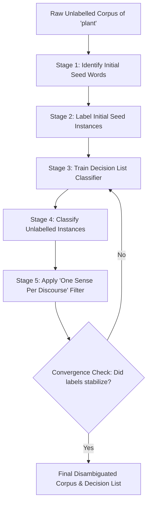

# Unit 4: Word Sense Disambiguation (WSD) & Yarowsky's Algorithm
**Direct Blueprint**: Based on `WSD_27_OCT_2026.pdf` (IIIT Surat, CS-702 / CS-913 / CS-703)  
**Crucial Exam Topics**: Sense Identification, Hypernyms, Yarowsky Bootstrapping, Divergence & Failure Modes, Naive Bayes WSD Formulation.

---

## 1. Multi-Document Sense Analysis of "Plant"
*(Exact solution to Question (a) in `WSD_27_OCT_2026.pdf`)*

### Corpus Snippets:
* **Doc 1**: *"...variety of plant life or flora in South Africa... plant kingdom... plant species... plant and animal life... largest genus of flowering plants..."*
* **Doc 2**: *"...tomato processing plant... plant technicians jobs... process operations of the plant... plant management... CEO of the plant..."*
* **Doc 3**: *"...plants' ability to adapt... half human, half plant... traditional food plants... tomato plant... medicinal plants..."*
* **Doc 4**: *"...magazine 'Plant Life', which humorously describes daily life at the Imperial food processing plant... published by a chemical plant process worker... small molecular commercial plants... pharmaceutical plants... heavy plant crossing..."*

### Identified Senses & Hypernyms:
1. **Sense 1: Botanical Organism (Flora)**
   * **Definition**: A living photosynthetic organism lacking locomotive movement (trees, flowers, herbs).
   * **Hypernym**: `organism` / `living thing` / `vascular plant`.
   * **Evidence**: Doc 1 ("plant kingdom", "flowering plants"), Doc 3 ("medicinal plants", "adapt to harsh circumstances"), Doc 4 (pun in title "Plant Life").
2. **Sense 2: Industrial Manufacturing Facility (Factory)**
   * **Definition**: A building or complex where industrial processes, manufacturing, or power generation occur.
   * **Hypernym**: `facility` / `building complex` / `manufacturing plant`.
   * **Evidence**: Doc 2 ("processing plant", "CEO of the plant", "plant technicians"), Doc 4 ("chemical plant", "food processing plant").
3. **Sense 3: Heavy Industrial Equipment / Machinery (Bonus nuance in Doc 4)**
   * **Definition**: Heavy mobile machinery or earthmoving vehicles (as in "heavy plant crossing" road sign).
   * **Hypernym**: `machinery` / `equipment`.

---

## 2. Yarowsky's Algorithm: Semi-Supervised Bootstrapping
*(Exact solution to Question (b))*

Yarowsky's algorithm disambiguates word senses using an **unsupervised or minimally supervised bootstrapping procedure** based on two strong linguistic heuristics:

```
            +-----------------------------------------------+
            | Two Foundational Heuristics of Yarowsky (1995)|
            +-----------------------------------------------+
                 |                                      |
                 v                                      v
   [ 1. One Sense Per Collocation ]      [ 2. One Sense Per Discourse ]
   Words in local context (±k words)     A polysemous word tends to preserve
   provide strong, reliable clues.       the SAME sense throughout one document.
```

### The 6 Stages of the Algorithm (Walkthrough with "Plant"):



#### Stage 1: Seed Selection
Choose a tiny number of representative words with unambiguous sense associations:
* **Sense A (Living Organism)** seed: collocation word `"life"` or `"species"`.
* **Sense B (Factory/Industrial)** seed: collocation word `"manufacturing"` or `"technician"`.

#### Stage 2: Initial Partitioning
Tag all instances containing the seed words in local context:
* "plant life" $\implies$ tagged as **Sense A**.
* "plant technicians" $\implies$ tagged as **Sense B**.
* All other instances remain **Unlabelled**.

#### Stage 3: Train Decision List Classifier
Extract context features (words within window $\pm k$, syntactic collocations) from labelled instances.  
Rank features by **Log-Likelihood Ratio**:
$$\text{Score}(f) = \left| \log_2 \frac{P(\text{Sense } A \mid f)}{P(\text{Sense } B \mid f)} \right|$$

*Example Decision List for "Plant":*
| Rank | Feature ($f$) | Predicted Sense | Log-Likelihood Score |
| :---: | :--- | :---: | :---: |
| 1 | `species` within $\pm 2$ words | Sense A (Flora) | 8.2 |
| 2 | `processing` immediately before `plant` | Sense B (Factory) | 7.9 |
| 3 | `medicinal` within $\pm 1$ word | Sense A (Flora) | 7.5 |
| 4 | `CEO of the` preceding `plant` | Sense B (Factory) | 6.8 |

#### Stage 4: Re-labelling the Corpus
Evaluate the decision list rules against the unlabelled instances. If an unlabelled instance matches a high-confidence rule (e.g. "tomato processing plant"), assign it **Sense B**.

#### Stage 5: Discourse-Level Filtering ("One Sense Per Discourse")
Check the sense distribution per document:
* If Document 2 has 5 instances of "plant", and 4 are tagged as **Sense B** while 1 is unlabelled or ambiguous, force the entire document to **Sense B**.

#### Stage 6: Iterate Until Convergence
Repeat Stages 3–5 with the newly expanded training set until no more labels change.

---

## 3. Why Yarowsky's Algorithm Diverges (Adverse Conditions)
*(Exact solution to Question (c))*

Under adverse conditions, the bootstrapping loop can rapidly undergo **Semantic Drift (Catastrophic Divergence)**:

```
False Seed / Ambiguous Rule --> Misclassifies 10 Instances
                                       |
                                       v
                     Decision List learns Noisy Feature
                                       |
                                       v
                    Cascading Misclassification across Corpus!
```

### The 4 Lethal Divergence Conditions:
1. **Violation of "One Sense Per Discourse"**:
   * *Example from Doc 4*: A humorous magazine titled *"Plant Life"* (Flora pun) published by a worker in a *"chemical food processing plant"* (Industrial).
   * If the algorithm enforces Discourse Consistency on Doc 4, it will mistakenly force "chemical plant" to become a botanical organism or "Plant Life" to become a factory!
2. **Ambiguous or Polysemous Seeds**:
   * If the chosen seed itself is polysemous (e.g., using `"tomato"` as a seed: "tomato processing plant" [Factory] vs "tomato plant" [Flora]), the decision list receives mixed supervision from day one.
3. **Imbalanced Corpus Distribution**:
   * If 95% of documents belong to Sense B, the prior dominates, and weak features get pulled entirely toward the dominant sense, causing minority sense erasure.
4. **Error Cascading (Semantic Drift)**:
   * Once a false collocation enters high in the decision list, every subsequent iteration uses those mislabelled sentences to extract more erroneous features, permanently derailing the model.

---

## 4. Naive Bayes for Word Sense Disambiguation
*(Exact solution to Question (d))*

Given a target ambiguous word $w$ and context features $\mathbf{f} = (f_1, f_2, \dots, f_m)$, find the most probable sense $\hat{s}$:
$$\hat{s} = \arg\max_{s_k \in S} P(s_k \mid f_1, f_2, \dots, f_m)$$

### Bayesian Formulation:
By Bayes' theorem:
$$P(s_k \mid \mathbf{f}) = \frac{P(s_k) \cdot P(f_1, \dots, f_m \mid s_k)}{P(\mathbf{f})}$$
Omitting the denominator $P(\mathbf{f})$ (constant across all senses):
$$\hat{s} = \arg\max_{s_k \in S} P(s_k) \cdot P(f_1, \dots, f_m \mid s_k)$$

### Naive Bayes Independence Assumption:
Assume context features $f_i$ are conditionally independent given sense $s_k$:
$$\hat{s} = \arg\max_{s_k \in S} \left[ P(s_k) \prod_{i=1}^m P(f_i \mid s_k) \right]$$
In log-space (to prevent numerical underflow):
$$\hat{s} = \arg\max_{s_k \in S} \left[ \log P(s_k) + \sum_{i=1}^m \log P(f_i \mid s_k) \right]$$

### Parameter Training via Maximum Likelihood with Laplace Smoothing:
From an annotated sense corpus (e.g., SemCor):
1. **Sense Prior Probability**:
   $$P(s_k) = \frac{C(s_k)}{N_{\text{total}}}$$
2. **Feature Likelihood (with Add-1 Laplace Smoothing)**:
   $$P(f_i \mid s_k) = \frac{C(f_i, s_k) + 1}{C(s_k) + |V|}$$
   where:
   * $C(f_i, s_k)$ is the count of feature $f_i$ appearing in contexts labelled with sense $s_k$.
   * $C(s_k) = \sum_{f'} C(f', s_k)$ is total feature count for sense $s_k$.
   * $|V|$ is the total feature vocabulary size.
